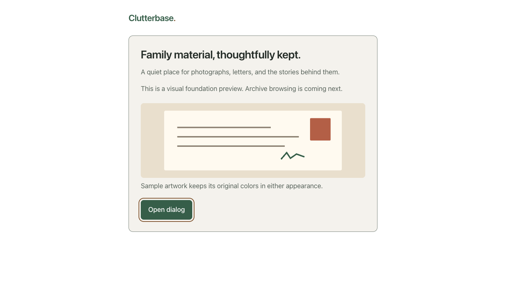
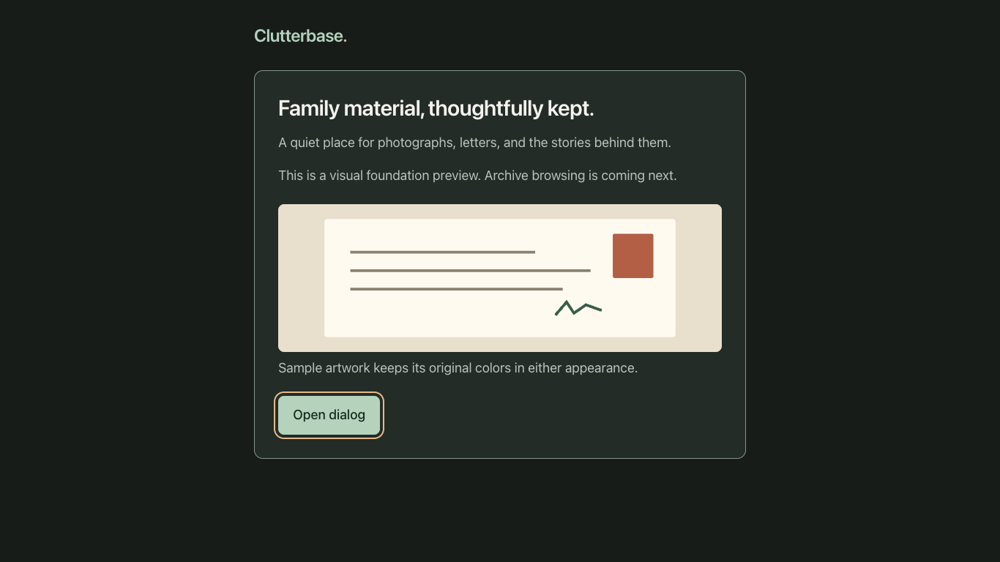

# Interface foundations

Issue [#3](https://github.com/switzerb/clutterbase/issues/3) establishes the visual foundation only. The current page is a temporary theme example, not the archive home or navigation implementation. Shared controls and status components belong to subsequent tickets.

## Appearance and semantic tokens

`src/style.css` is the source of truth. Tailwind v4 `@theme` tokens use native CSS `light-dark()`; root `color-scheme: light dark` follows system appearance immediately, without JavaScript, stored preferences, a manual toggle, or repeated `dark:` classes. Use a current browser supporting `light-dark()` (Chrome/Edge 123+, Firefox 120+, Safari 17.5+).

| Token / utility suffix | Light       | Dark        | Usage                                      |
| ---------------------- | ----------- | ----------- | ------------------------------------------ |
| `canvas`               | `#ffffff`   | `#171c19`   | Page background                            |
| `surface`              | `#f4f2ed`   | `#232c26`   | Warm grouped content                       |
| `surface-raised`       | `#ffffff`   | `#2c372f`   | Dialogs / elevated content                 |
| `foreground`           | `#252d28`   | `#f4f2ed`   | Main text                                  |
| `muted`                | `#59645c`   | `#b9c4ba`   | Secondary text, not disabled text          |
| `border`               | `#778279`   | `#859589`   | Essential boundaries                       |
| `accent`               | `#365e49`   | `#b4d2bc`   | Wordmark, links, primary action background |
| `accent-hover`         | `#294b39`   | `#cee4d3`   | Primary action hover                       |
| `on-accent`            | `#ffffff`   | `#172b1e`   | Text on either action background           |
| `focus`                | `#805530`   | `#e8b989`   | Keyboard outline, small branding accent    |
| `success`              | `#326044`   | `#add5b8`   | Future success text                        |
| `warning`              | `#79501f`   | `#edc58c`   | Future warning text                        |
| `danger`               | `#a03535`   | `#ffb4ac`   | Future error text                          |
| `info`                 | `#365b7b`   | `#aecfe9`   | Future informational text                  |
| `overlay`              | `#171c1980` | `#00000099` | Dialog scrim only; not a text surface      |

Examples: `bg-canvas text-foreground`, `border-border bg-surface text-muted`, `bg-accent text-on-accent hover:bg-accent-hover`. Do not use literal palette colors in components. Status tokens are reserved for text on the three neutral surfaces; future components must also provide meaningful labels, not color alone. New pairings require their own contrast measurements.

Photos and document previews must never receive theme filters, inversion, opacity, or blend-mode treatments. The synthetic letter at `public/theme-sample.svg` is public-safe verification artwork, not an archive fixture. The rounded corners expose the surrounding surface; the interior artwork pixels remain identical across appearances.

## Typography, spacing, and branding

- Friendly system sans-serif: `ui-sans-serif`, `system-ui`, Apple system fonts, Segoe UI, then sans-serif. No font downloads.
- Body and default Tailwind `text-base`: `1.125rem` (18px at a 16px browser default), line height 1.6. Rem sizing preserves user font preferences. Do not shrink body copy to make it fit.
- Use restrained semibold headings (`text-3xl` for the example) and a `text-2xl font-semibold tracking-tight` Clutterbase wordmark. The trailing warm dot is decorative and excluded from the accessible name.
- Use Tailwind's standard 4px spacing rhythm: 8px for tight related content, 16px between text blocks, 24px between groups, 32px for section spacing. Example page gutters are 20px narrow / 32px wider; panel padding is 20px / 32px.
- `min-h-control` maps to `3rem` (48px default). Combine with content-driven padding; long labels must wrap rather than clip. The existing demo action measures about 53px high.
- Base `:focus-visible` provides a 2px warm outline with a 4px offset. Preserve that gap around filled actions so the outline contrasts against the neutral surface.
- `public/favicon.svg` uses a simple white C and warm dot on evergreen. It deliberately keeps the same high-contrast colors in both appearances and remains distinct from archive media.
- The existing Reka dialog is retained as a themed example. This ticket does not introduce a component suite, shared control API, or new motion.

## Measured contrast

WCAG relative sRGB luminance ratios, rounded to two decimals. Within each cell, values are against **canvas / surface / surface-raised**, respectively. All text is tested against the stricter normal-text AA minimum of **4.5:1**; borders and focus require **3:1**. `src/__tests__/theme.spec.ts` measures the actual CSS values, including all reserved status tokens.

| Foreground | Light ratios          | Dark ratios           |
| ---------- | --------------------- | --------------------- |
| foreground | 14.14 / 12.64 / 14.14 | 15.43 / 12.86 / 11.08 |
| muted      | 6.17 / 5.52 / 6.17    | 9.59 / 7.99 / 6.89    |
| accent     | 7.36 / 6.58 / 7.36    | 10.59 / 8.83 / 7.60   |
| success    | 7.26 / 6.49 / 7.26    | 10.67 / 8.90 / 7.66   |
| warning    | 7.05 / 6.30 / 7.05    | 10.66 / 8.88 / 7.65   |
| danger     | 6.87 / 6.14 / 6.87    | 10.17 / 8.48 / 7.30   |
| info       | 7.14 / 6.39 / 7.14    | 10.60 / 8.84 / 7.61   |
| border     | 4.00 / 3.57 / 4.00    | 5.47 / 4.56 / 3.93    |
| focus      | 6.44 / 5.76 / 6.44    | 9.64 / 8.04 / 6.92    |

| Action text / background | Light | Dark  |
| ------------------------ | ----- | ----- |
| on-accent / accent       | 7.36  | 9.20  |
| on-accent / accent-hover | 9.72  | 11.18 |

## Visual examples and evidence

### Light



### Dark



The [machine-readable browser record](design/verification.json) includes the actual Chrome version, computed styles, and successful checks. The screenshots show the keyboard focus outline. The check emulates system media preferences in a real browser, changing light to dark on the **same loaded page**. It checks 18px body text, minimum action height, no horizontal overflow at 1366, 683, and 320 CSS pixels, and identical interior artwork screenshots across themes.

Ticket verification passed: `vp check`, `vp test` (64 tests), `vp run type-check`, `vp run build`, and the real-browser check against `vp run preview`.

These are foundation checks, not the full milestone acceptance record: 683px is a narrow/reflow check, not a claim of actual 200% browser zoom. Full navigation, actual zoom, cross-screen keyboard journeys, and final integrated review remain later tickets. Palette and font remain subject to visual review.

### Reproduce

```sh
vp check
vp test
vp run type-check
vp run build
vp run preview --host 127.0.0.1
```

In a second terminal, from the repository root:

```sh
vp node scripts/verify-theme.mjs
```

The dependency-free script uses the installed Google Chrome on macOS and a temporary, isolated profile that it cleans up. Override `CHROME_PATH` for another Chrome/Chromium location or `PREVIEW_URL` for another preview address. It rewrites the screenshots and JSON record; inspect their diffs before committing. It does not require Playwright or a browser-testing dependency.

For interactive review, open the preview, switch system appearance (or use browser `prefers-color-scheme` emulation) while it remains open, and inspect the canvas, text, image, and dialog. Tab to Open dialog, press Enter, then Escape; confirm visible focus returns to its trigger. The Vue tests retain dialog labeling, close-button, and Escape coverage.
